<p align="center">
  
</p>

<p align="center">
  <picture>
    <source media="(prefers-color-scheme: dark)" srcset="https://readme-typing-svg.demolab.com?font=JetBrains+Mono&weight=500&size=20&duration=3200&pause=900&color=FCF1D0&center=true&vCenter=true&width=620&height=40&lines=Desenvolvedor+Full+Stack;Python+e+Django+no+backend;React+e+React+Native+na+tela;Aplica%C3%A7%C3%B5es+de+IA">
    
  </picture>
</p>

<br>

## Sobre mim

Sou desenvolvedor full stack na **InterTV**, afiliada da Globo no interior do Rio. Passo a maior parte do tempo no backend, com APIs em Django, microsserviços, banco de dados, filas e containers, além de desenvolver apps mobile e frontend.

Hoje meu foco é o **IRIS**, uma plataforma interna que usa IA para ajudar a redação a acompanhar o que acontece na região. É software que roda todo dia na mão de jornalistas, então estabilidade vem antes de qualquer firula.

Nos últimos meses tenho trabalhado com observabilidade, testes de carga, avaliação de modelos de linguagem e agentes de IA. A regra é sempre a mesma: medir antes de mexer.


```text
base      Região dos Lagos, RJ
trabalho  InterTV · tecnologia
stack     Python · Django · React · React Native
agora     agentes de IA · observabilidade · avaliação de LLMs
```

<br>

## Tecnologias

<table align="center">
  <tr>
    <td align="right" width="110"><sub><b>BACKEND</b></sub></td>
    <td align="center" width="88"><br><sub>Python</sub></td>
    <td align="center" width="88"><br><sub>Django</sub></td>
    <td align="center" width="88"><br><sub>FastAPI</sub></td>
    <td align="center" width="88">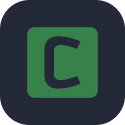<br><sub>Celery</sub></td>
    <td align="center" width="88"><br><sub>Telegram Bot</sub></td>
    <td width="88"></td>
    <td width="88"></td>
  </tr>
  <tr>
    <td align="right"><sub><b>FRONTEND</b></sub></td>
    <td align="center"><br><sub>React</sub></td>
    <td align="center"><br><sub>JavaScript</sub></td>
    <td align="center"><br><sub>Next.js</sub></td>
    <td align="center"><br><sub>Vite</sub></td>
    <td align="center"><br><sub>HTML</sub></td>
    <td align="center"><br><sub>CSS</sub></td>
    <td></td>
  </tr>
  <tr>
    <td align="right"><sub><b>MOBILE</b></sub></td>
    <td align="center"><br><sub>React Native</sub></td>
    <td align="center">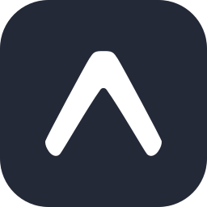<br><sub>Expo · Go</sub></td>
    <td align="center"><br><sub>Kotlin</sub></td>
    <td align="center"><br><sub>Android Studio</sub></td>
    <td></td>
    <td></td>
    <td></td>
  </tr>
  <tr>
    <td align="right"><sub><b>DADOS</b></sub></td>
    <td align="center"><br><sub>PostgreSQL</sub></td>
    <td align="center"><br><sub>Redis</sub></td>
    <td align="center"><br><sub>Supabase</sub></td>
    <td align="center">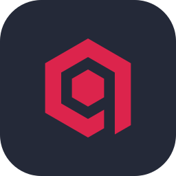<br><sub>Qdrant</sub></td>
    <td></td>
    <td></td>
    <td></td>
  </tr>
  <tr>
    <td align="right"><sub><b>IA</b></sub></td>
    <td align="center">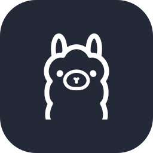<br><sub>Ollama</sub></td>
    <td align="center">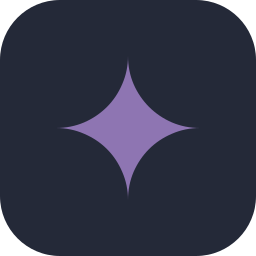<br><sub>Gemini</sub></td>
    <td align="center">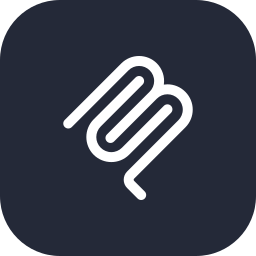<br><sub>MCP</sub></td>
    <td align="center">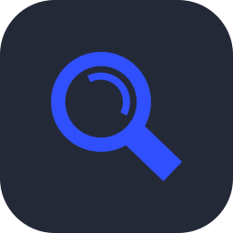<br><sub>SearXNG</sub></td>
    <td></td>
    <td></td>
    <td></td>
  </tr>
  <tr>
    <td align="right"><sub><b>INFRA</b></sub></td>
    <td align="center"><br><sub>Docker</sub></td>
    <td align="center"><br><sub>Linux</sub></td>
    <td align="center"><br><sub>Ubuntu</sub></td>
    <td align="center"><br><sub>Nginx</sub></td>
    <td align="center"><br><sub>Prometheus</sub></td>
    <td align="center"><br><sub>Grafana</sub></td>
    <td align="center"><br><sub>Cloudflare</sub></td>
  </tr>
  <tr>
    <td align="right"><sub><b>GESTÃO</b></sub></td>
    <td align="center"><br><sub>Git</sub></td>
    <td align="center">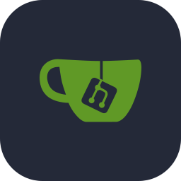<br><sub>Gitea</sub></td>
    <td align="center">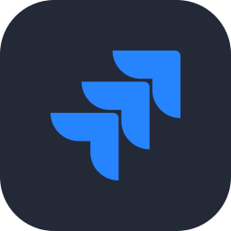<br><sub>Jira</sub></td>
    <td></td>
    <td></td>
    <td></td>
    <td></td>
  </tr>
</table>

<p align="center">
  <sub>também no dia a dia: LLMs locais · avaliação de modelos · engenharia de prompt</sub>
</p>

<br>

## Projetos

### Na InterTV

<table>
  <tr>
    <td colspan="2" valign="top">
      
      <h3>IRIS</h3>
      <p>Plataforma de monitoramento e curadoria de notícias com IA, feita para apoiar o trabalho da redação. Atuo no backend, nos microsserviços e na infraestrutura.</p>
      <p>Algumas frentes em que trabalhei:</p>
      <ul>
        <li>Agentes de IA com modelos rodando localmente</li>
        <li>Observabilidade e painéis de métricas</li>
        <li>Testes de carga e planejamento de capacidade</li>
        <li>Avaliação comparativa de modelos de linguagem</li>
        <li>Adequação à LGPD e políticas de retenção de dados</li>
        <li>Monitoramento climático a partir de fontes oficiais</li>
        <li>Alertas automáticos via Telegram</li>
        <li>Protótipos de agentes que pesquisam a fundo um assunto usando MCP</li>
      </ul>
      <p>
        
        
        
        
        
        
        
        
        
      </p>
    </td>
  </tr>
  <tr>
    <td width="50%" valign="top">
      
      <h3>IRIS Mobile</h3>
      <p>App para a equipe acompanhar notícias e alertas direto do celular, conectado ao mesmo backend da plataforma.</p>
      <p>
        
        
        
      </p>
    </td>
    <td width="50%" valign="top">
      
      <h3>InterTime</h3>
      <p>App Android que mostra ao repórter, em tempo real, o tempo definido para a reportagem.</p>
      <p>
        
        
        
      </p>
    </td>
  </tr>
  <tr>
    <td colspan="2" valign="top">
      
      <h3>Plataforma de Gestão Executiva</h3>
      <p>Melhorias de segurança na aplicação web interna, com autenticação em dois fatores (MFA) para administradores.</p>
      <p>
        
        
        
      </p>
    </td>
  </tr>
</table>

### Por conta própria

<table>
  <tr>
    <td width="50%" valign="top">
      
      <h3>LipeTV</h3>
      <p>Um TV Box antigo e lento que estava guardado virou o sistema de TV da casa dos meus avós. Limpei o aparelho, codei um launcher próprio no estilo minimalista futurista e personalizei a tela de inicialização com uma saudação para eles. Tudo com logo próprio e atalhos direto para os apps que eles usam.</p>
      <p>
        
        
        
      </p>
    </td>
    <td width="50%" valign="top">
      
      <h3>Jarvis</h3>
      <p>Estou construindo meu agente pessoal de IA. A ideia é ter um servidor central num notebook reaproveitado com Linux, enquanto celular, TV e computador funcionam só como clientes. As prioridades são custo próximo de zero, modelo de IA trocável, privacidade desde o início e arquitetura pronta para rodar IA local.</p>
      <p>
        
        
        
      </p>
    </td>
  </tr>
</table>

<br>

## No GitHub

<p align="center">
  
  &nbsp;
  
</p>

<p align="center">
  
</p>

<!--
  Gráfico de atividade: o serviço público está fora do ar.
  Para ativar, hospede sua própria instância de github.com/Ashutosh00710/github-readme-activity-graph
  na Vercel, troque SEU-DOMINIO abaixo e remova as marcações de comentário.

<p align="center">
  
</p>
-->

<p align="center">
  
</p>

<p align="center">
  <picture>
    <source media="(prefers-color-scheme: dark)" srcset="https://raw.githubusercontent.com/LipeVaz/LipeVaz/output/snake-dark.svg">
    
  </picture>
</p>

<br>

## Onde me encontrar

<p align="center">
  <a href="https://www.linkedin.com/in/fellipevaz/"></a>
  <a href="https://www.instagram.com/lipez_vaz/"></a>
</p>

<br>

<p align="center">
  
</p>

<p align="center">
  <sub><b>FELLIPE VAZ</b> · Região dos Lagos, RJ</sub>
  <br>
  <sub>fim da transmissão · obrigado pela visita</sub>
</p>